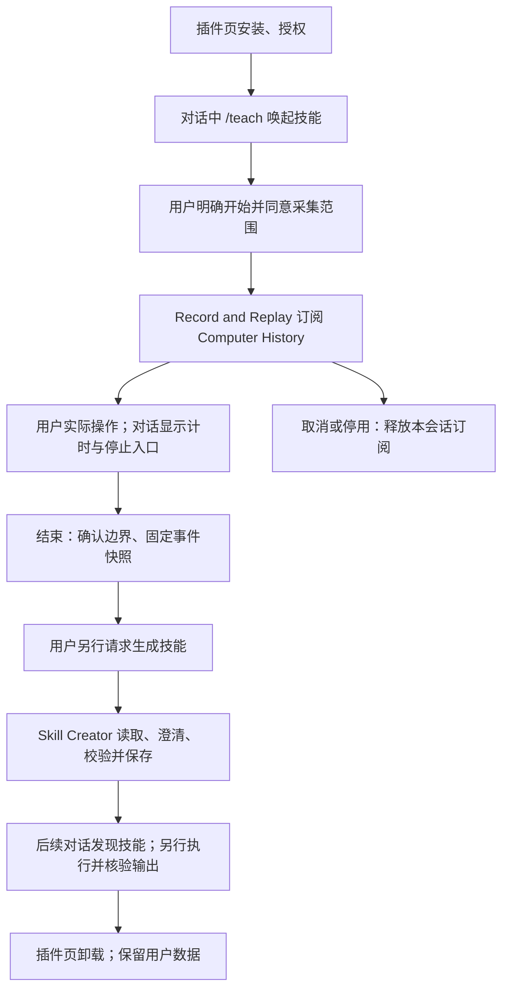

# Teach Mode：Windows 流程、代码索引与 macOS 接入

更新：2026-10-27。Host 的 `pxlin/dev` 已合并本轮 Windows Teach Mode 修复及 Mac 原生实现；插件在独立 `Jovianix/teach-mode` 仓库的 `main`，开发版本 **0.4.1**。这批代码供后续 Mac 实机测试，尚未作为正式版本发布。

## 当前用户流程

浏览器教学现另有独立来源：沿用日常 Chrome/Edge 登录态创建教学窗口，只采集该窗口及其浏览器证明的弹窗。
接口、边界、截图与实机证据见 [浏览器录制实现](teach-mode-browser-capture.md)。原有桌面采集与后台 History 保持独立。

下载安装和卸载在独立插件页完成；教学控制及技能生成在当前对话完成。0.1 的 Web → Notepad 执行器仅用于 Windows 旧技能兼容，当前流程使用 Record and Replay 与 Skill Creator。



| 阶段 | 行为与实现 |
| --- | --- |
| 安装 | 插件页发现目录、下载固定 ZIP、核验 SHA-256、平台及 Host 能力，审批后启用。Host 管理包与进程。 |
| 唤起 | `/teach` 的 `agentSkillId` 指向 `record-and-replay`，工具栏准备对话指令。仅唤起不录制、不打开独立教学面板。 |
| 开始 | 用户明确目标和同意后，Agent 调用 `record_and_replay(start, goal, consent:true)`。插件反向请求 `memmy/host-service`，Host 绑定真实插件与对话身份，创建事件会话。 |
| 采集 | `PluginEventSessions` 申请 Computer History 订阅。已有采集器继续共享；原来暂停/停止时临时启动并保留后台意图。前端查询真实状态，显示计时、结束与取消。 |
| 结束 | `stop(session_id)` 固定截止时间；checkpoint 经原生队列、归一化和 fsync 后返回精确字节位置，Host 冻结片段。返回事件数、应用、可用性、限制及哈希，不生成技能。 |
| 生成 | 用户另行请求 `/teach-skill`。`create_skill.prepare` 提供本对话片段、事件页、真实 Host Skill Creator 指令和工具目录；Agent 补齐参数与缺失证据，再 `save` 提交草稿。 |
| 保存 | 插件原子写入 `SKILL.md` 与 `references/`，Host 核验文件、来源哈希、依赖和重名，再发布活动索引。返回 `execution:not_run`。 |
| 复用 | 后续轮次发现技能，用户另行要求使用后，Agent 调用当前平台工具执行，独立检查任务输出。生成成功不等于执行成功。 |
| 停用 | 对话中的 Host `plugin_manage` 可停用/启用；释放录制、停止 worker、撤下插件与生成技能贡献，保留文件。 |
| 卸载、重装 | 插件页移除安装包和记录，保留用户片段及技能；重装后重新校验、恢复有效贡献。 |

## 全链路代码索引

Host 文件相对于本仓库；插件文件相对于独立 `teach-mode` 仓库。

| 所属 | 文件 | 职责 |
| --- | --- | --- |
| 插件 | `teach-mode/plugin.json` | 平台、Host 依赖、权限、对话命令、技能和能力 |
| 插件 | `teach-mode/src/index.ts` | MCP worker、调用上下文、反向服务、Windows 旧版隔离与关闭 |
| 插件 | `teach-mode/src/conversation-plugin.ts` | 录制转发、prepare/save、证据校验、原子保存及技能发布 |
| 插件 | `teach-mode/skills/record-and-replay/SKILL.md` | 授权、开始、停止、取消及生成阶段边界 |
| 插件 | `teach-mode/skills/teach-skill-creator/SKILL.md` | 分页读取、澄清、参数化、草稿格式与后续执行要求 |
| Host | [MPP 契约](../App/backend/local-api-contracts/src/plugin.ts) | 清单、对话贡献与 `PLUGIN_HOST_CAPABILITIES` |
| Host | [事件会话契约](../App/backend/local-api-contracts/src/event-capture.ts) | 状态、来源范围、计数、限制、哈希 |
| Host | [服务装配](../App/backend/src/services/index.ts) | 安装、Registry、技能、原生服务、更新与生命周期 |
| Host | [MCP adapter](../App/backend/src/adapters/outbound/plugin-runtime/mcp-adapter.ts) | 常驻进程、宿主 Node/Electron、原生信任、身份与反向请求 |
| Host | [原生服务路由](../App/backend/src/services/plugin-native-host-services.ts) | 授权、对话归属、dataRoot、心跳与租约释放 |
| Host | [Agent 原生服务](../App/memmy-agent/src/tools/plugin-host/native-services.ts) | event-sessions、平台/系统版本与能力探测；Windows 旧服务 |
| Host | [事件快照](../App/memmy-agent/src/tools/plugin-host/event-sessions.ts) | 起止、分页、精确位置、内容哈希、对话隔离、中断恢复 |
| Host | [共享 History 业务](../App/memmy-agent/src/tools/computer-history/core/computer-history-api.ts) | `acquireEventCapture`、后台意图、轮转、checkpoint 与健康状态 |
| Host | [Windows 驱动](../App/memmy-agent/src/tools/computer-history/win/computer-history-api.ts) | Windows 原生启动、授权、共享租约 |
| Host | [Windows recorder](../App/memmy-agent/src/tools/computer-history/win/recorder.ts) | 原生协议、顺序归一化、缺口和磁盘水位 |
| Host | [C++ 控制](../App/memmy-agent/src/tools/computer-history/win/native/src/win/commands.cpp) | 原生 checkpoint 和控制命令 |
| Host | [动态技能注册](../App/backend/src/services/plugin-generated-skills.ts) | 文件、来源、工具、重名及所有者校验 |
| Host | [Agent 技能发现](../App/memmy-agent/src/core/agent-runtime/plugin-skills.ts) | 每轮核验索引，停用或篡改后撤下 |
| Host | [对话入口](../App/frontend/desktop/src/pages/home-page.tsx) | 命令、工具栏和 Agent 技能路由 |
| Host | [状态条](../App/frontend/desktop/src/pages/plugin-conversation-recording.tsx) | 当前对话状态、计时、结束/取消、生成提示 |

## Windows 当前状态

0.3 的真实对话、截图和生成技能复用记录见 [基线适配记录](plugin-host-baseline-adaptation-2026-10-20.md)。旧记录中的 `partial` 不因后续修复而改变。

后续 C++ FIFO checkpoint、缺口记录、持久化确认与区间修复见 [原生 checkpoint 专项](teach-mode-native-checkpoint-2026-10-21.md)。`available` 表示按采集策略观测的片段边界可确认，不代表每个应用或网页步骤都有证据；应用/网站授权、排除规则与缺失步骤仍需检查或由用户澄清。

同一应用实例内共享一个 Computer History 采集器。另一个 Memmy 实例仍可能占用 Windows 桌面会话的原生锁，需要在占用实例中处理。

## 2026-10-27 官方分支合并复测

`pxlin/dev` 已通过 `c04392b0` 合并官方 `MemTensor/memmy-agent:1.2.7`（`0ad11348`），没有冲突。官方分支的文件树与共同祖先一致，因此本次合并只补齐提交关系，未改变源码；实际 package 版本仍为 **1.2.4**。

Windows 上继续使用 **qwen3.8-max-0902**，重新演示许志钦 Publications 第 1 条、生成 `copy-publications-v127-1027`，生成结束后新建任务和独立 Chrome 窗口，再调用该 skill 复制第 2—5 条。四条通过实际网页输入、一次保存及本地读取完成，作者、标题、年份、链接与跨分类顺序的独立核验均通过；示范文件与新 skill 未被执行阶段修改。

本轮采集为 **partial**：30 个事件，保留 `browser_capture_boundary_unconfirmed`，执行成功不改变录制完整性。构建、类型检查及 Host 能力检查通过；定向回归 **457 项通过、2 项既有 History 测试失败**（Windows 图标读取和仅控制记录的空摘要），没有将它们计为通过。实机复测沿用已安装的插件 0.4.1 与 Windows 原生二进制，插件源码另行通过构建及测试，Mac 实机验收仍待进行。哈希、具体断言与环境修正见 [合并复测记录](verification/teach-mode-v127-2026-10-27.json)。

## macOS 本次补齐

Mac 沿用同一对话、事件会话、技能生成及生命周期链路，最低系统为现有原生运行时要求的 **macOS 14**。插件 0.4.1 声明 `win32` / `darwin`，并要求新增的 `memmy.event-checkpoints/v1`；相同预发布版本号的旧 Host 仍需通过实际能力检查。

| Mac 文件 | 接入内容 |
| --- | --- |
| [human-recorder.swift](../App/memmy-agent/src/tools/computer-history/mac/human-recorder.swift) | 会话标识和顺序号、毫秒时间、不可丢弃的 enrichment barrier、有界 stdin 控制；采样合并不能跨过 barrier |
| [main.swift](../App/memmy-agent/src/tools/computer-history/mac/main.swift) | 源码入口接收 checkpoint，stdin 结束时停止采集 |
| [MacOSAppAgentProxy.swift](../App/native-computer-use/apps/OpenComputerUse/Sources/OpenComputerUse/MacOSAppAgentProxy.swift) | 正式 app-agent 双向转发；事件读取和控制写入使用不同描述符，避免 stdio 互相等待；断连清理 |
| [打包的 HistoryRecorder.swift](../App/native-computer-use/apps/OpenComputerUse/Sources/MemmyComputerHistoryKit/HistoryRecorder.swift) | 同步源码实现，正式应用包含相同功能 |
| [record-human-history.ts](../App/memmy-agent/src/tools/computer-history/mac/record-human-history.ts) | 打开控制管道；标记到达时立即排入归一化队列，刷完输入后固定位置 |
| [persisted-checkpoint.ts](../App/memmy-agent/src/tools/computer-history/mac/persisted-checkpoint.ts) | 写入无用户内容的控制记录并 fsync，返回确切字节位置，后续事件不能扩大该位置 |
| [recorder-checkpoints.ts](../App/memmy-agent/src/tools/computer-history/mac/recorder-checkpoints.ts) | 请求校验、去重、超时、落盘后回执和失败处理 |

桌面连续采集已补齐到 Mac：受控录制器声明能力后，Host 在原生 barrier 处切换十分钟事件文件；原生进程、输入钩子、采样及健康缺口记录持续保留。每个新文件重新建立自己的完整脱敏 AX 快照和页面上下文，旧文件在交接后保持固定。轮转超时、原生不完整或磁盘失败都不能返回成功，旧录制器未声明能力时沿用重启兼容路径。

源码和打包 History kit 已统一到当前源码行为，包含原生 checkpoint；Mac 的应用/站点观察策略沿用当前主线，浏览器教学另有教学窗口和隐私模式限制。

Mac barrier 确认原生到磁盘的边界，原生不单独宣称已评估整个录制区间。Host 继续结合采集健康判断可用性，超时或缺口保留不完整状态。Windows 旧 Web → Notepad 执行器不在 Mac 初始化或发布旧技能，误调用时返回明确平台提示。

## Mac 配置与使用

1. 使用包含本次改动的 Mac Host 与插件 0.4.1，核对可信来源、平台、SHA-256 和所需能力。
2. 按 Host 提示，为实际运行的 Memmy 原生应用授权“辅助功能”和必要的“输入监控”。正式版与开发辅助应用各自使用注册的权限身份。
3. 事件录制使用 `--no-screenshots`，不以视频或屏幕录制授权为开始条件。后续技能若调用截图工具，应满足该工具的权限要求。
4. 在对话发送 `/teach` 确认待命，再明确要求开始、进行实际操作，然后发“结束录制”或点击状态条结束。
5. 检查时间、事件数和限制；另发“根据刚才的录制生成 skill”，在对话中补充缺失信息。保存后另行请求复用并检查输出。
6. 核对 History 原为运行、暂停、停止时的恢复；刷新、单次 Agent 回复结束不应误停录制。停用、卸载和崩溃应清理资源。

开发需要 Node 22 与项目 Swift 工具链；用户运行时由 Host 提供。开发原生应用构建和稳定路径安装沿用现有脚本：

```sh
# Mac Host 仓库；先退出正在使用的开发辅助应用。
bash scripts/internal/mac/build-memmy-computer-use.sh \
  "$PWD/App/native-computer-use/dist/Memmy Computer Use.app" "$(uname -m)" -
node scripts/internal/mac/install-dev-computer-use.mjs

# 独立插件仓库
npm ci --legacy-peer-deps
npm run typecheck -w @memmy/teach-mode-plugin
npm test
npm run build
```

[dev-start.sh](../scripts/dev-start.sh) 会使用稳定路径设置 `MEMMY_DEV_COMPUTER_USE_BINARY`；正式版使用打包原生应用与现有签名/权限身份。

本地 Registry 只提供开发制品读取。单独设置 `MEMMY_PLUGIN_REGISTRY_URL` 不会让任意来源获得原生信任。跨仓夹具显式信任隔离的回环 Registry，不修改日常应用的云服务；线上接入仍按此前暂缓范围处理。

## 2026-10-26 交接与验证

拉取两个开发分支后，先按上面的命令重建、安装 Mac 原生辅助应用，再启动 Host 并安装对应插件开发 ZIP。浏览器扩展需更新/重新加载至 **1.2.2**。具体测试步骤及本地回归结果见 [本轮同步记录](verification/teach-mode-macos-sync-2026-10-26.json)。

Host 仓库当前禁用 GitHub Actions；本轮推送没有自动运行，手动触发返回 HTTP 422，故不宣称 Mac 原生编译已通过。插件仓库的 macOS、Windows、Linux CI 均已通过类型检查、53 项插件测试、4 项发布合同测试和 ZIP 构建；Mac CI 发现的旧数据迁移目录别名问题也已修复。

Mac 实机重点：Chrome/Edge 的标签移出/移回、移出同时停止；桌面连续录制跨一个十分钟整点，核对前后 `nativeSessionId` 一致、旧文件固定、新文件快照完整；停止热键、系统权限拒绝/恢复、技能生成与独立复用。

## 历史验证范围（2026-10-21）

Linux 可验证 TypeScript、插件业务、持久化位置、Host 共享事件服务，以及下载 ZIP 后真实 MCP worker 的安装、Mac 平台模拟、生成、停用/重装。原生 Swift 测试在非 Mac 环境跳过；原生测试和完整 native app 编译已加入 Host Mac CI。

插件 CI 和固定 Host 制品 conformance 均增加 Mac runner。正式发布新增 `MEMMY_MACOS_ACCEPTANCE_REPORT`，检查安装版、宿主 Node、app-agent 身份、TCC 拒绝与恢复、原生边界、真实模型对话、试运行和独立输出证据。

**本轮环境为 Linux/WSL，没有 Mac 桌面及 Swift 工具链。Mac 原生编译、系统授权、真实桌面和模型四步流程尚未在此环境执行。后续 Mac 实机验收由使用者执行。** 本地 ZIP 与 Host kit 是 `dirty:true` 的开发制品，不满足正式发布门槛，也不覆盖旧 0.3.0 包。Mac 验收格式见独立插件仓库的 `docs/macos-teach-mode.md`。

本轮实际验证：Host 定向回归 151 项通过、16 项平台条件跳过；插件业务 27 项通过；发布契约 4 项通过；真实 ZIP/MCP 跨仓合同 6 项通过。Agent、Backend 和插件类型检查通过。重复运行按测试名称去重，详情与开发包哈希见 验证摘要（本地归档 `verification/teach-mode-macos-development-2026-10-21.json`）。

历史实机证据保留在验收工作区的本地归档中；本次分支交付源码与同步结果，不包含这些历史截图及原始录制文件。
